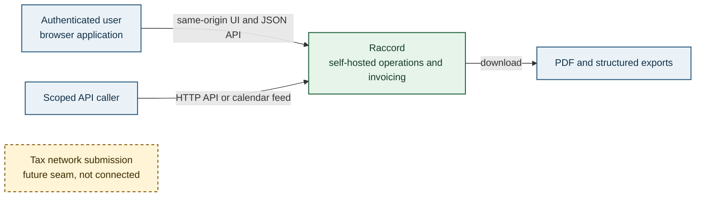
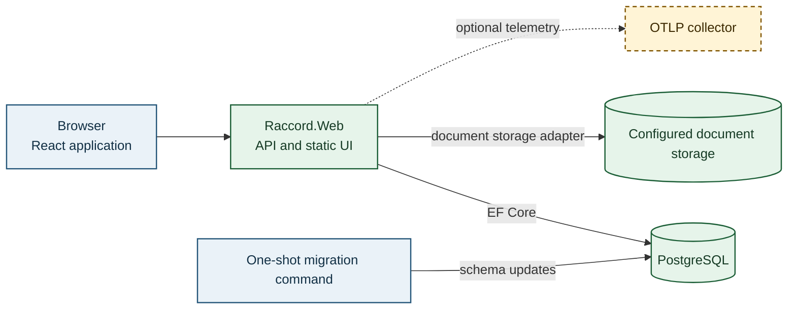

<!-- markdownlint-disable MD025 -->

# 3. Context and scope

## Business context

The browser UI and protected JSON API are served from the same web host. Scoped API callers use explicit integration credentials; the application also provides a personal calendar feed. Files are produced for download or received through the API. The tax-submission seam remains local and has no network sender (see [compliance seam](../compliance-seam.md)).

## Technical context

## Scope

Raccord currently provides authenticated project, crew and contact workflows; invoicing and related documents; scoped integration endpoints; audit and compliance records; and self-hosted or Azure deployment paths. The diagrams show the implemented system boundary and mark external tax submission as a future seam rather than a running integration.

No outbound tax-network or B2B-platform exchange is implemented. Email delivery is not part of the current boundary.
