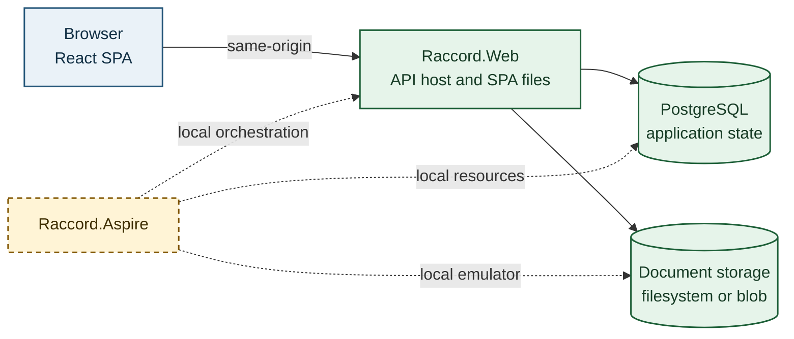
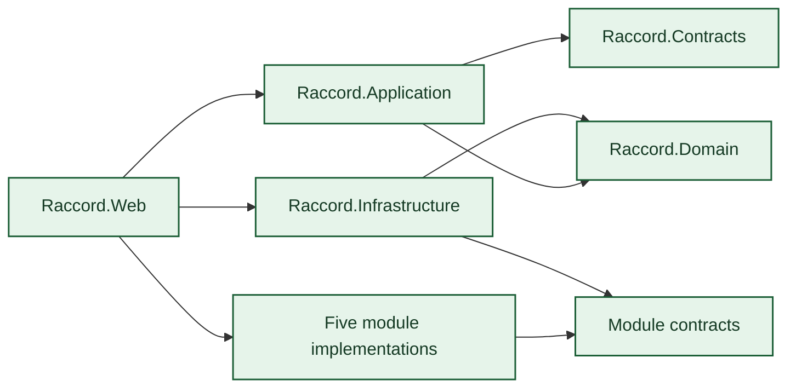
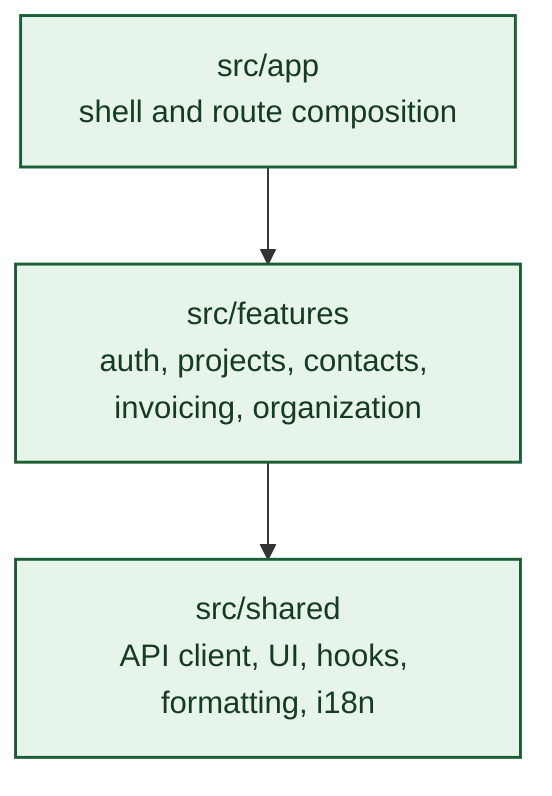

<!-- markdownlint-disable MD025 -->

# 5. Building block view

## Level 1 — deployable and projects

The solution entry points are `src/root/Raccord.Web/Raccord.Web.csproj` and `src/root/Raccord.Aspire/Raccord.Aspire.csproj`; they link source from `src/Raccord.Web` and `src/Raccord.Aspire`. The web project composes application, infrastructure, shared libraries and five module implementations. In the diagram, the web host represents those in-process project references; the source boundaries are shown separately below.

| Block                                    | Responsibility                                                                                                                                                    | Evidence                                                         |
| ---------------------------------------- | ----------------------------------------------------------------------------------------------------------------------------------------------------------------- | ---------------------------------------------------------------- |
| `Raccord.Web`                            | HTTP API, authentication and SPA hosting                                                                                                                          | `src/Raccord.Web/Program.cs`, `src/Raccord.Web/Api/Endpoints.cs` |
| `Raccord.Application`                    | Cross-module workflows, including invoice operations                                                                                                              | `src/Raccord.Application/`                                       |
| `Raccord.Domain` and `Raccord.Contracts` | Shared domain rules and API contracts                                                                                                                             | `src/Raccord.Domain/`, `src/Raccord.Contracts/`                  |
| `Raccord.Infrastructure`                 | EF Core persistence, storage and module adapters                                                                                                                  | `src/Raccord.Infrastructure/DependencyInjection.cs`              |
| Contacts module                          | Company/person contact directory, tags and hierarchical folders, spreadsheet import, customer compatibility projection and party lookup for projects and invoices | `src/modules/Contacts/`                                          |
| Workspace module                         | Issuer settings, invoice series and workspace identity                                                                                                            | `src/modules/Workspace/`                                         |
| Projects module                          | Projects, account-manager assignment, named time periods, linked crew and transport planning, project context, time and coordination                              | `src/modules/Projects/`                                          |
| Invoicing module                         | Invoice contracts and lifecycle                                                                                                                                   | `src/modules/Invoicing/`, `src/Raccord.Application/Invoicing/`   |
| Compliance module                        | Audit and compliance records                                                                                                                                      | `src/modules/Compliance/`                                        |

Project coordination and project context are owned by the Projects module. Invoicing consumes module contracts for contacts, projects and workspace data; infrastructure implements persistence adapters against those contracts.

Projects reads eligible account-manager candidates through a module-owned directory port; Infrastructure adapts the Workspace identity store and the Projects workflow validates Admin or Office role membership before saving the assignment.

The project schedule is persisted with the project aggregate. Crew and transport functions generated from selected periods keep a nullable period link in crew planning persistence; updating a linked period propagates its date range and shift offsets within the same database transaction. Functions without a period link keep their own dates (BR-PRJ-FUNCTIONS-FROM-PERIODS, BR-PRJ-LINKED-PERIOD-PROPAGATION).

## Level 2 — domain modules

The dependency direction remains `Raccord.Web` → application and module implementations → module contracts and shared abstractions. `Raccord.Infrastructure` supplies database and document-store adapters; modules do not depend on the web host. Project references and architecture tests enforce this boundary.

## Level 2 — frontend

The frontend entry point composes authentication around the router; the authenticated application routes and the public sign-in route are defined in `src/Raccord.Frontend/src/main.tsx` and `src/Raccord.Frontend/src/app/routes.tsx`.

The Contacts feature owns the `/contacts` directory, create/edit forms, organization controls for `UC-CON-TAG-CONTACTS` and `UC-CON-MANAGE-CONTACT-FOLDERS`, and the spreadsheet import flow for `UC-CON-IMPORT-CONTACTS`; the `/customers` route remains the customer-only compatibility view used by existing workflows. Project selectors and invoice preparation continue to resolve parties by the stable customer identifier through the Contacts module contract. Tags and folders belong to the deployment's Contacts dataset; ADR-0012 keeps company isolation at the database-per-deployment boundary, with no tenant key or client-selected workspace in these APIs.
