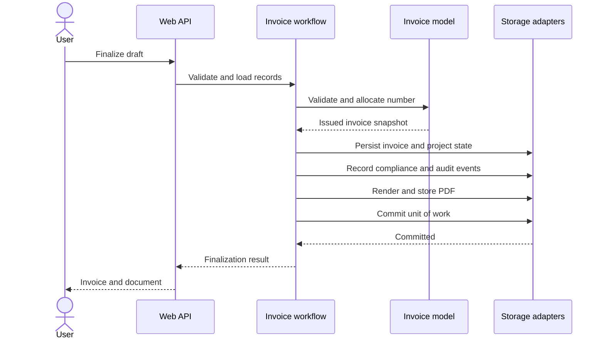

<!-- markdownlint-disable MD025 -->

# 6. Runtime view

## R-1 Create a draft

1. `POST /api/invoice-drafts {projectId, billableLineIds, seriesCode?}`.
2. `InvoicingWorkflow` loads the project and resolves the series (default when omitted).
3. `InvoiceDraft.CreateFromProject` asks the project to reserve the lines (unbilled → in draft), ordered by line position, and copies them.
4. Audit `invoice-draft.created`; one `SaveChanges`. A concurrent reservation of the same line fails on `xmin` → 409, or on the domain rule → 422.
5. The response includes server totals and validation issues for today's date.

## R-1a Receive and convert project work

1. `POST /api/project-coordination/requests` validates the optional customer and persists the request, source contact and requested classifications.
2. The coordinator either declines the request with a reason or calls the conversion endpoint.
3. Conversion creates the project and marks the original request converted in the same unit of work; missing customer links are rejected.

<!-- pdac:cite id="UC-PRJ-CONVERT-PROJECT-REQUEST" digest="sha256:7efe604979d08b83572e4bf7e9441cef0e69f20f7e51645a99419d611c473a50" -->

## R-1b Cancel a project

1. `GET /api/projects/{id}/cancellation-preview` counts open tasks, planned crew and vehicles, active invitations, and whether a completing task status is configured.
2. The operator selects only the applicable cleanup actions and confirms cancellation.
3. `ProjectWorkspace` completes selected tasks, removes selected crew and vehicle assignments, withdraws selected active invitations, and cancels the project in one shared database transaction.
4. The cancellation warning reflects work the operator left open; issued invoices and invoiced work remain unchanged.

<!-- pdac:cite id="UC-PRJ-CANCEL-PROJECT" digest="sha256:80e15e9d11dba906cb7d753fd78b7ce8b29c30651bfe9cdb9ac1d7cdc3118d96" -->
<!-- pdac:cite id="BR-PRJ-CANCEL-PRESERVES-INVOICED-WORK" digest="sha256:383aadaf0babcb79c58e36c9c9559532ceb4589ad3b8bc92f409874c012ae258" -->

## R-1c Generate and move period-linked planning

1. The operator selects one or more timed project periods and Crew and/or Transport, then requests function generation.
2. The API validates the selection, project status and period ownership before adding one function for each selected period and requested kind with a period link.
3. Updating a period runs in the Projects unit of work; linked functions receive the new date range and their shifts retain their day offset from the old start date.
4. If a linked shift would fall outside the new range, the operation is rejected and the period, functions and shifts remain unchanged. Unlinked functions keep their independent dates.

This behavior follows BR-PRJ-FUNCTIONS-FROM-PERIODS and BR-PRJ-LINKED-PERIOD-PROPAGATION.

## R-0 Sign in and authorize the application

1. The frontend restores the session through `GET /api/auth/me`. The response includes the account display name, personal language preference and a role-management capability derived from the user's current role claims. `PUT /api/auth/me` updates only the authenticated user's display name and supported personal language.
2. If no cookie session exists, `RequireAuth` redirects the browser to `/sign-in`.
3. `POST /api/auth/sign-in` validates the local Identity password and establishes the `raccord.session` cookie; the sign-out endpoint clears it.
4. The `/api` group requires an authenticated user. The sign-in endpoint and infrastructure health endpoints are anonymous; test bypass authentication is explicit configuration.

## R-2 Finalize (issue) an invoice

1. `POST /api/invoice-drafts/{id}/finalize {issueDate?}`; default date is today in the organization time zone.
2. Load draft (must be open), project, customer, issuer profile and the sequence for (series, year) — created if missing.
3. `draft.Validate(...)` → any issue → 422 `draft.invalid` with all issues; nothing is written, no number consumed.
4. `draft.Finalize(...)` allocates the next number, snapshots parties and lines, and returns `IssuedInvoice`; the project marks the lines invoiced.
5. Build `IssuedInvoiceRepresentation` (JSON + SHA-256); store it append-only; register the compliance record; audit `invoice.issued`.
6. Render the PDF, store it in object storage, audit `invoice.document.stored` with the PDF hash.
7. Commit everything in one transaction. If the commit fails, the stored PDF is an orphan under a deterministic key and no invoice exists.

## R-2a Change issuer legal identity after issuance

1. Before any invoice has been issued, an authorized administrator may update the issuer legal name and tax id directly.
2. After issuance, the administrator submits a reasoned identity-change request; address and contact changes remain direct profile updates.
3. The request stores the current and proposed legal identity, requester and timestamp. A partial unique index permits only one pending request per issuer.
4. A distinct authorized administrator approves or rejects the request. `xmin` concurrency ensures only one decision wins; the requester cannot decide their own request.
5. Approval updates the issuer profile for future invoices. Previously issued invoice snapshots remain unchanged. Request and decision audit records commit with their state changes; rejected requests remain in history.

<!-- pdac:cite id="FR-ISSUER-001" digest="sha256:1d443dcade4a5af9dce47d75a383a243a298dd37de5a2d1be22bc80d5dfe1712" -->

## R-3 Maintain and browse contacts

1. `POST /api/contacts` validates company/person type, required legal name and one or more supported roles; the database sequence assigns a unique contact number when omitted.
2. The Contacts adapter persists contact details in the existing `contacts.customers` identity table and role membership in `contacts.contact_roles`; migration backfills old rows as company/customer records without changing their IDs.
3. `GET /api/contacts` filters by role and orders by contact number then ID before applying bounded pagination; `PUT /api/contacts/{id}` updates the current record while preserving its identifier.
4. `GET /api/customers` remains a customer-role projection over the same records so project and invoice consumers keep their current contract and cannot see supplier-only or venue-only contacts.
5. Invoice issuance snapshots current party details. Editing a contact changes future invoice inputs but does not update any already issued invoice representation.
6. `POST /api/contacts/import/inspect` reads a bounded CSV/XLSX file for column mapping; `/preview` validates every row without writes and returns a digest; `/import` recomputes that digest, persists valid contacts independently, reports rejected rows and appends start/completion audit events containing counts and file type without row values (`UC-CON-IMPORT-CONTACTS`, `BR-CON-IMPORT-ROW-ATOMICITY`, `BR-CON-IMPORT-AUDIT`).
7. Administrators create deployment-scoped tags and hierarchical folders, assign them to contacts, and filter the directory with folder membership or any/all tag matching. Tag assignments and folder membership use restrictive foreign keys; folders with contacts or child folders and tags with assignments cannot be deleted. This uses the existing database-per-deployment boundary from ADR-0012 and does not implement workspace selection or multi-tenant row partitioning (`UC-CON-TAG-CONTACTS`, `UC-CON-MANAGE-CONTACT-FOLDERS`, `UC-CON-FILTER-CONTACT-DIRECTORY`, `BR-CON-FOLDER-DELETE-NONEMPTY`, `BR-CON-TAG-FILTER-MODES`).

This flow follows `src/Raccord.Application/Invoicing/InvoicingWorkflow.cs` and the web endpoint mapping in `src/Raccord.Web/Api/Endpoints.cs`; a failed validation returns before number allocation or persistence.

## R-3 Read an invoice / download its document

1. Load the stored JSON; recompute the hash; mismatch → 500 `issued-invoice.integrity-violation` + critical log.
2. For the document: read from storage; if missing, render again from the representation (identical bytes), store it and audit `invoice.document.regenerated`.

## R-4 Start-up and migration

- Compose: `postgres` healthy → `migrate` (`dotnet Raccord.Web.dll migrate`) applies EF migrations and reference series → exits 0 → `web` starts → readiness checks the database.
- Aspire: the same sequence with `migrate --seed-demo`, plus Azurite and the Vite dev server.
- Azure: run the Container Apps Job, then roll the Container App.

## R-4a Back up and restore an installation

1. The operator runs the host-side backup script; PostgreSQL exports records and the document volume exports stored files into a temporary set.
2. The script writes the checksum manifest and publishes the set atomically only after both exports succeed; completed sets beyond the configured retention window are removed.
3. The restore script verifies the manifest before stopping `web`, recreates the database schema, restores documents and starts the migration gate before `web`.
4. Readiness verification confirms the restored application can reach the database; a checksum mismatch exits before the installation is changed.

## R-5 Future: VERI\*FACTU submission

A background worker claims pending compliance records per issuer in order, builds/sends batches, stores evidence, and handles outages and rejections (see [compliance seam](../compliance-seam.md)).

For task progression, the Projects coordination service validates the configured status, moves the task, and recalculates project progress from statuses marked complete.

<!-- pdac:cite id="UC-PRJ-PROGRESS-STATUS-AUTOMATICALLY" digest="sha256:cd576d336c8096b0e71096d084bb2258c78c0d81522848e32a78730276caafed" -->
