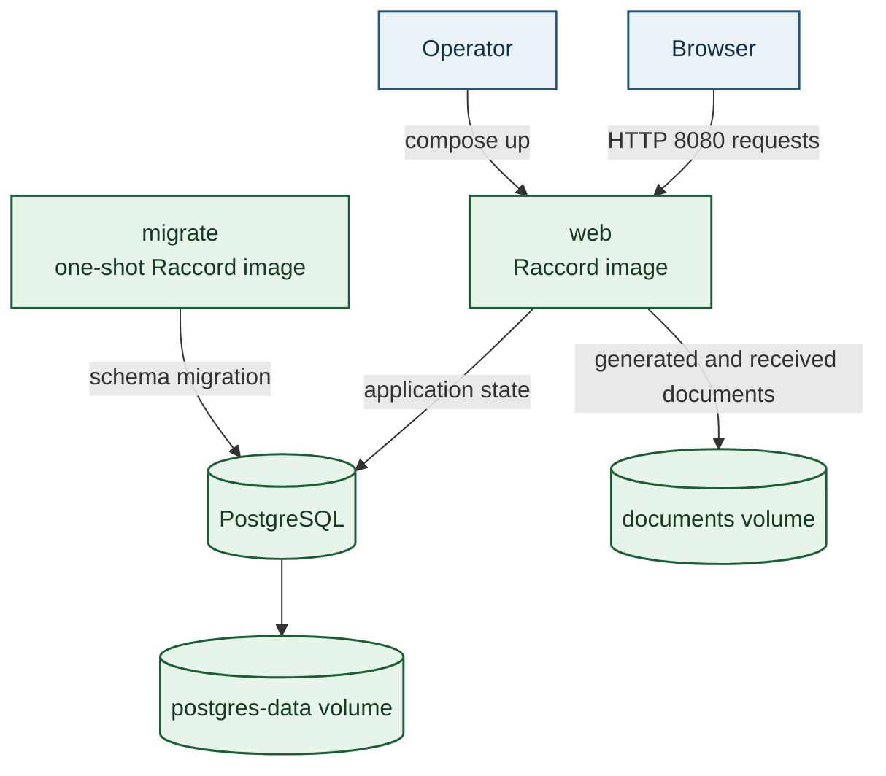
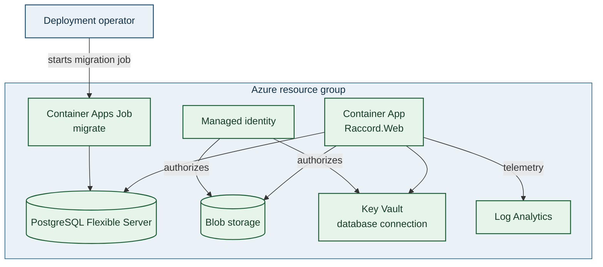

<!-- markdownlint-disable MD025 -->

# 7. Deployment view

All paths use the same container image built by `deploy/docker/Dockerfile` (ADR-0013). Stable `vMAJOR.MINOR.PATCH` tags publish official images to GitHub Container Registry through `.github/workflows/release.yml`; GitHub Releases record the image digest. Self-hosted Compose deployments pin that digest. Development and custom builds do not carry the official release support promise (ADR-0026).

## Docker Compose (self-hosting)

Configuration: `deploy/.env` (from `.env.example`) pins `RACCORD_IMAGE` to a release tag or digest. The host-side upgrade script pulls that image, verifies a database and document backup, applies migrations and replaces `web` only after the migration succeeds. Backup sets record the running image reference, so restore can recover the database, documents and compatible web image together. Operations: [self-hosting](../../operations/self-hosting.md), [backup and restore](../../operations/backup-and-restore.md). Put a TLS-terminating reverse proxy in front for anything beyond a trusted LAN.

## .NET Aspire (development)

`dotnet run --project src/root/Raccord.Aspire`: PostgreSQL (volume), Azurite (volume), `migrations` resource, `web` (API) and `frontend` (Vite with proxy). Dashboard with logs, traces and metrics. See [local development](../../operations/local-development.md).

## Azure (Bicep)

The Bicep modules own the Azure resource definitions. The migration job runs as a separate deployment step; it is not a continuously running application container.

See [Azure deployment](../../operations/azure-deployment.md).

## Public engineering snapshots

The repository's GitHub Pages site serves a generated arc42 snapshot, the ProductShape model snapshot, and nightly Playwright reports. The publisher is serialized; architecture and model pages refresh only when their respective source paths change, while the latest E2E report is generated by the nightly workflow. Reports contain fictional seeded data and browser recordings and are public. See [nightly E2E reports](../../operations/nightly-e2e-reports.md) and [ADR-0024](../../adr/0024-publish-static-engineering-snapshots-on-github-pages.md).

## Public homepage

The Spanish homepage source lives in `src/public-site/`; its build writes only `index.html` and `styles.css` to `dist/`. `.github/workflows/public-site.yml` validates that output independently from the GitHub Pages engineering publisher. The accepted Cloudflare Pages Git integration targets this subtree and output directory, with preview branches and a disabled `main` production deployment until Owner approval; the `raccord.dev` domain is not bound. See [public-site deployment](../../operations/public-site-deployment.md) and [ADR-0025](../../adr/0025-host-the-public-site-on-cloudflare-pages.md).
