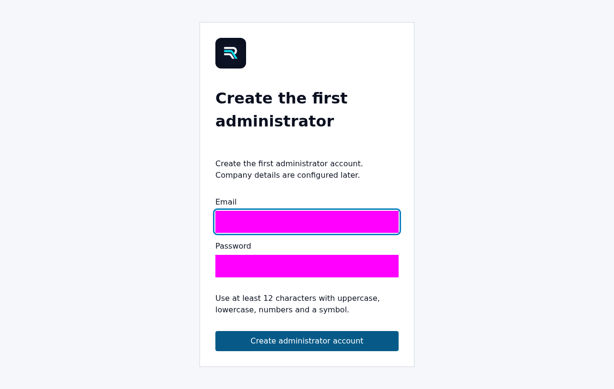
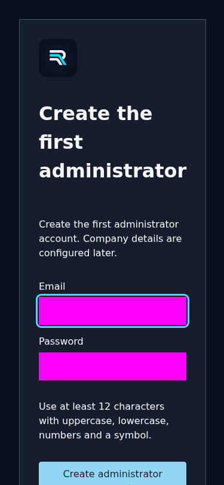

# Visual evidence for #294

Stage: implement. Source: `3747480a3a7ebcdc2f514afe7f9f7fd725cc78ff`. Candidate tree: `5668f41ae7c2c619de511cb10951fb04069b9381`.

Actual running product: admitted-source/candidate sign-in comparisons and real fresh-AppHost first-run captures. Masked synthetic UI-state captures supplement, not replace, backend acceptance.

## sign-in-1280-before: before

View: /sign-in. State: Initialized installation, signed out, English. Viewport: 1280 × 812. Producer: agent-declared capture.

## sign-in-1280-candidate: candidate

View: /sign-in. State: Initialized installation, signed out, English. Viewport: 1280 × 812. Producer: agent-declared capture.

## sign-in-375-before: before

View: /sign-in. State: Initialized installation, signed out, English. Viewport: 375 × 812. Producer: agent-declared capture.

## sign-in-375-candidate: candidate

View: /sign-in. State: Initialized installation, signed out, English. Viewport: 375 × 812. Producer: agent-declared capture.

## setup-1280-candidate: candidate

View: /setup. State: Fresh installation, first administrator form. Viewport: 1280 × 812. Producer: agent-declared capture.

## setup-375-candidate: candidate

View: /setup. State: Fresh installation, first administrator form. Viewport: 375 × 812. Producer: agent-declared capture.

Proposed designs are illustrative. Candidate captures are agent-declared; the host verifies their bytes and binds them to the independently checked candidate tree. Images grant no visual acceptance, merge or release approval.
