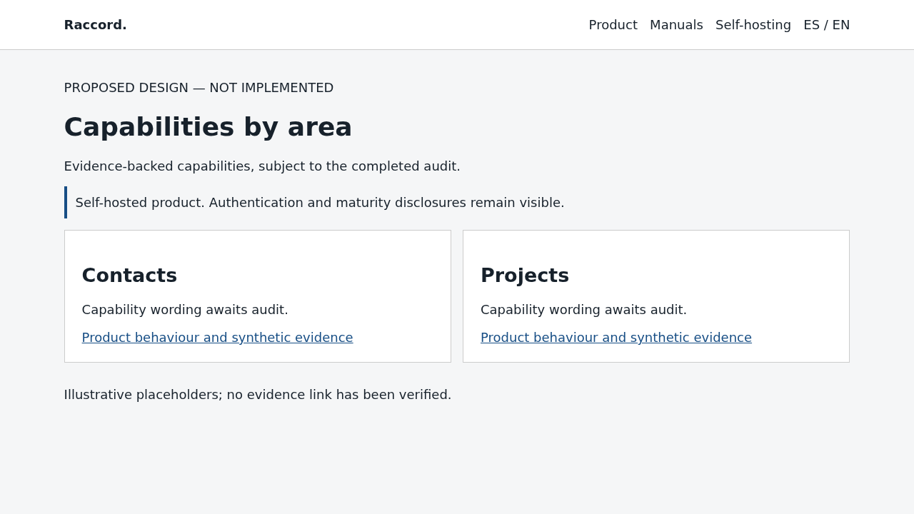
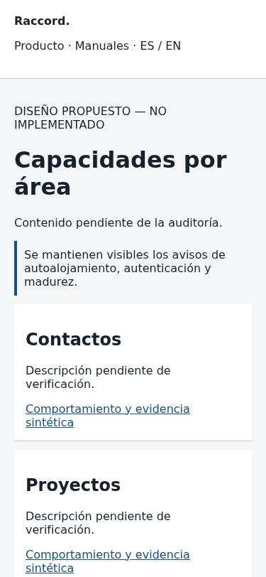

# Visual evidence for #338

Stage: refine. Source: `58c3cf4c3772998c7c6f5f30599243e1fd7876dc`. Candidate tree: `not an implementation`.

The bilingual product page, evidence links and responsive layout change. These are proposed wireframes only; placeholders assert no implemented capability.

## product-inventory-wide: proposal

View: Product capability inventory. State: Proposed English product page with evidence links. Viewport: 1280 × 720. Producer: isolated proposed-design renderer.

## product-inventory-narrow: proposal

View: Product capability inventory. State: Proposed Spanish product page at narrow width. Viewport: 375 × 812. Producer: isolated proposed-design renderer.

Proposed designs are illustrative. Candidate captures are agent-declared; the host verifies their bytes and binds them to the independently checked candidate tree. Images grant no visual acceptance, merge or release approval.
